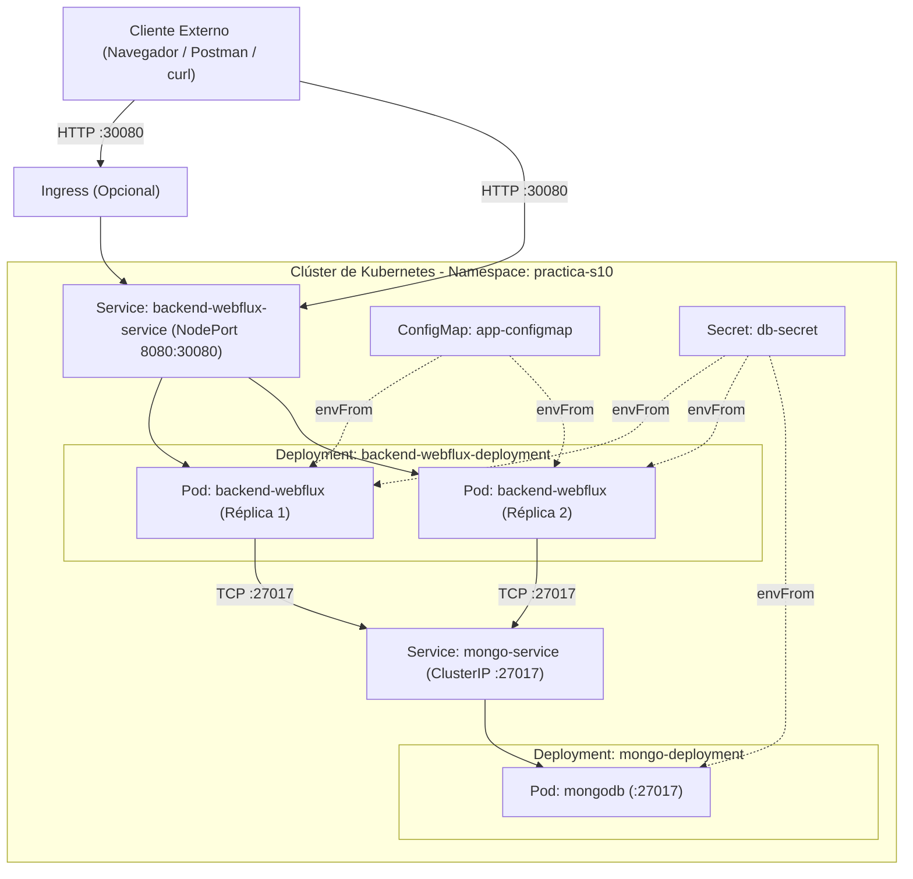

# S10 | M10: Despliegue de Backend Spring WebFlux y MongoDB en Kubernetes

## 1. Descripción General

Este proyecto contiene el código fuente y los manifiestos de Kubernetes para desplegar una arquitectura reactiva de dos capas compuesta por un backend en **Spring WebFlux (Java 17)** y una base de datos **MongoDB 7.0**.

A diferencia de una aplicación web tradicional bloqueante, todo el flujo de datos de este repositorio está diseñado para trabajar de forma asíncrona de principio a fin:
- **Backend Reactivo:** Construido sobre el servidor embebido **Netty** y **Project Reactor**, capaz de atender múltiples solicitudes concurrentes con pocos hilos de ejecución.
- **Persistencia NoSQL Reactiva:** Conexión hacia MongoDB mediante `spring-data-mongodb-reactive`, evitando que las consultas a base de datos detengan los hilos del servidor.
- **Configuración Desacoplada en Kubernetes:** Uso de `Namespace`, `ConfigMap`, `Secret`, `ClusterIP` y `NodePort` para separar las variables de entorno y credenciales de la imagen del contenedor.

### Estructura del proyecto

```text
S10-M10-Despliegue-Spring-WebFlux-y-MongoDB/
├── k8s/
│   ├── 01-app-configmap.yaml       # Variables públicas (DB_HOST, DB_PORT, DB_NAME, APP_PORT)
│   ├── 02-db-secret.yaml           # Credenciales de MongoDB en Base64
│   ├── 03-mongo-stack.yaml         # Deployment de MongoDB y Service ClusterIP (27017)
│   └── 04-backend-stack.yaml       # Deployment de Spring WebFlux y Service NodePort (30080)
├── src/
│   ├── main/
│   │   ├── java/pe/edu/vallegrande/webfluxk8s/
│   │   │   ├── WebfluxMongoK8sApplication.java
│   │   │   ├── controller/ProductController.java
│   │   │   ├── service/ProductService.java
│   │   │   ├── repository/ProductRepository.java
│   │   │   └── model/Product.java
│   │   └── resources/
│   │       └── application.yml
│   └── test/
│       └── java/pe/edu/vallegrande/webfluxk8s/service/ProductServiceTest.java
├── Dockerfile
├── pom.xml
└── README.md
```

---

## 2. Fundamentos Conceptuales

### 2.1. Paradigma Reactivo vs. Imperativo

En el enfoque clásico con **Spring MVC y Apache Tomcat**, el servidor asigna un hilo del sistema operativo por cada petición que entra (*One Thread per Request*). Si ese hilo hace una consulta a la base de datos y la respuesta tarda 200 ms, el hilo se queda esperando sin hacer nada hasta que la base de datos responda. Cuando el tráfico sube de golpe, el pool de hilos se agota y las nuevas peticiones quedan en cola o son rechazadas.

En **Spring WebFlux con Netty**, el servidor trabaja con un **Event Loop** (un número reducido de hilos, normalmente asociado a la cantidad de núcleos de CPU). Cuando una petición necesita ir a MongoDB, se registra un callback y el hilo queda libre de inmediato para atender a otros clientes. Cuando MongoDB termina y devuelve los datos, el Event Loop retoma la respuesta y la envía al cliente.

| Criterio | Enfoque Imperativo (Spring MVC) | Enfoque Reactivo (Spring WebFlux) |
| :--- | :--- | :--- |
| **Modelo de hilos** | Un hilo por petición (*Thread per Request*) | *Event Loop* no bloqueante |
| **Servidor por defecto** | Apache Tomcat | Reactor Netty |
| **Operaciones de entrada/salida (I/O)** | Síncronas y bloqueantes | Asíncronas orientadas a eventos |
| **Tipos de datos en el código** | Objetos directos (`Product`, `List<Product>`) | Flujos reactivos (`Mono<Product>`, `Flux<Product>`) |
| **Manejo de contrapresión (Backpressure)** | No aplica | Soportado nativamente |
| **Uso de recursos en contenedores** | Mayor consumo de memoria por cantidad de hilos | Consumo de memoria estable bajo alta concurrencia |

### 2.2. Project Reactor: `Mono` y `Flux`

Spring WebFlux utiliza **Project Reactor** para manejar la programación reactiva a través de dos tipos principales que implementan la interfaz `Publisher<T>`:

- **`Mono<T>` (0 o 1 elemento):** Se utiliza cuando la operación devuelve como máximo un único resultado o ninguno. Por ejemplo: buscar un registro por su ID (`findById`), guardar un nuevo documento (`save`) o eliminar un registro.
- **`Flux<T>` (0 a N elementos):** Se utiliza cuando la operación devuelve una lista o secuencia continua de datos a lo largo del tiempo. Por ejemplo: listar todos los productos (`findAll`) o emitir eventos en tiempo real mediante *Server-Sent Events (SSE)*.

```text
Mono<T> (0..1):
Suscripción  ------>  [ Elemento T ]  ------>  | onComplete()

Flux<T> (0..N):
Suscripción  ------>  [ T1 ] ---> [ T2 ] ---> [ T3 ] ------>  | onComplete()
```

Un detalle fundamental en programación reactiva es que **nada se ejecuta hasta que alguien se suscribe** al flujo. Al retornar un `Mono` o un `Flux` en el controlador, el propio motor de Spring WebFlux realiza la suscripción cuando llega la petición HTTP.

### 2.3. Por qué necesitamos un driver reactivo en MongoDB

No sirve de nada tener un controlador en Spring WebFlux si para conectarnos a la base de datos usamos un driver tradicional bloqueante (como JDBC clásico). Si hacemos eso, el hilo del Event Loop de Netty se va a quedar detenido esperando la respuesta de la base de datos y terminaremos bloqueando todo el servidor.

Al utilizar `spring-data-mongodb-reactive`, el driver de MongoDB también trabaja de forma asíncrona sobre canales de red no bloqueantes. De esa manera, el flujo completo —desde que entra la petición HTTP hasta que vuelve el documento desde MongoDB— se mantiene libre de bloqueos.

---

## 3. Arquitectura de la Solución en Kubernetes

### 3.1. Flujo de Red dentro del Clúster (`namespace: practica-s10`)



### 3.2. Configuración y Seguridad (ConfigMap, Secret y tipos de Service)

Para que la imagen Docker del microservicio pueda reutilizarse en distintos entornos sin volver a compilar el código, externalizamos toda su configuración:

1. **`ConfigMap` (`01-app-configmap.yaml`):**
   Guarda los datos públicos de conexión: el puerto de la aplicación (`APP_PORT=8080`), el nombre de la base de datos (`DB_NAME=vallegrande_reactive_db`) y el host de MongoDB (`DB_HOST=mongo-service`). El valor `mongo-service` corresponde al nombre del Service interno de Kubernetes, resuelto automáticamente por el DNS del clúster.
2. **`Secret` (`02-db-secret.yaml`):**
   Almacena el usuario (`MONGO_INITDB_ROOT_USERNAME`) y la contraseña (`MONGO_INITDB_ROOT_PASSWORD`) codificados en Base64. Este mismo Secret se inyecta tanto en el contenedor de MongoDB (para crear el usuario administrador al iniciar) como en el contenedor de Spring WebFlux (para autenticarse).
3. **Diferencia entre `ClusterIP` y `NodePort`:**
   - **MongoDB (`ClusterIP`):** La base de datos nunca debe quedar expuesta hacia afuera del clúster. Con `ClusterIP`, el puerto `27017` solo existe dentro de la red interna de Kubernetes.
   - **Backend WebFlux (`NodePort`):** Expone el microservicio en el puerto `30080` del nodo para que podamos realizar pruebas desde el navegador, Postman o `curl`.

---

## 4. Paso a Paso de Despliegue

### Paso previo: Construir la imagen Docker del microservicio

Desde la carpeta raíz del proyecto, compilamos y generamos la imagen local:

```bash
docker build -t vallegrande/webflux-mongo-k8s:1.0.0 .
```

Si estás trabajando con **Minikube** o **Kind** (en lugar de Docker Desktop), recuerda cargar la imagen dentro del clúster:
```bash
# Solo en caso de usar Minikube:
minikube image load vallegrande/webflux-mongo-k8s:1.0.0

# Solo en caso de usar Kind:
kind load docker-image vallegrande/webflux-mongo-k8s:1.0.0
```

### Paso 1: Crear el Namespace (`practica-s10`)

```bash
kubectl create namespace practica-s10
kubectl get namespaces
```

### Paso 2: Aplicar el ConfigMap y el Secret

```bash
kubectl apply -f k8s/01-app-configmap.yaml
kubectl apply -f k8s/02-db-secret.yaml

# Confirmar que se crearon correctamente
kubectl get configmaps,secrets -n practica-s10
```

### Paso 3: Desplegar MongoDB y validar el Pod

```bash
kubectl apply -f k8s/03-mongo-stack.yaml

# Verificar que el Pod pase a estado Running y que el Service sea ClusterIP
kubectl get pods,svc -l app=mongo-db -n practica-s10
```

### Paso 4: Desplegar el Backend Spring WebFlux

```bash
kubectl apply -f k8s/04-backend-stack.yaml

# Observar el levantamiento de las 2 réplicas
kubectl get pods -n practica-s10 -w
```

Para revisar todos los objetos creados en el namespace:

```bash
kubectl get all,configmaps,secrets -n practica-s10
```

---

## 5. Verificación y Pruebas de Conectividad

### 5.1. Comprobar la inyección de variables dentro del Pod (`kubectl exec`)

Primero listamos los Pods para copiar el nombre de cualquiera de las réplicas del backend:

```bash
kubectl get pods -n practica-s10 -l app=backend-webflux
```

Luego ejecutamos el comando `env` dentro del contenedor para verificar que las variables del `ConfigMap` y del `Secret` están presentes en memoria:

```bash
kubectl exec -it <nombre-del-pod-backend> -n practica-s10 -- env
```

Entre las variables listadas veremos:
```text
APP_PORT=8080
DB_HOST=mongo-service
DB_PORT=27017
DB_NAME=vallegrande_reactive_db
MONGO_INITDB_ROOT_USERNAME=admin
MONGO_INITDB_ROOT_PASSWORD=secret123
```

### 5.2. Pruebas de peticiones HTTP al Service NodePort (`30080`)

#### 1. Consultar información de entorno e hilo reactivo
```bash
curl http://localhost:30080/api/v1/products/info
```
Respuesta de ejemplo:
```json
{
  "service": "Spring WebFlux + MongoDB Reactive Microservice",
  "podHostname": "backend-webflux-deployment-6b8f9d4c7-x9k2p",
  "reactiveEventLoopThread": "reactor-http-epoll-2",
  "injectedConfigMap": {
    "DB_HOST": "mongo-service",
    "DB_NAME": "vallegrande_reactive_db",
    "APP_PORT": "8080"
  },
  "timestamp": "2026-11-11T15:10:00.123456"
}
```
Si ejecutamos la petición varias veces seguidas, veremos cómo `podHostname` alterna entre las dos réplicas del Deployment.

#### 2. Listar los productos registrados en MongoDB (`Flux<Product>`)
```bash
curl http://localhost:30080/api/v1/products
```

#### 3. Registrar un nuevo producto (`Mono<Product>`)
```bash
curl -X POST http://localhost:30080/api/v1/products \
  -H "Content-Type: application/json" \
  -d '{
    "name": "Servidor Redis Enterprise",
    "category": "Database NoSQL",
    "price": 280.00,
    "stock": 10
  }'
```

#### 4. Probar el endpoint de streaming reactivo (Server-Sent Events)
```bash
curl -N http://localhost:30080/api/v1/products/stream
```
Este endpoint emite un producto por segundo sin bloquear los hilos de Netty.

---

## 6. Troubleshooting y Buenas Prácticas

### 6.1. Comandos habituales de diagnóstico

- **Ver los eventos de un Pod que no termina de levantar (`Pending`, `ImagePullBackOff` o `CrashLoopBackOff`):**
  ```bash
  kubectl describe pod <nombre-del-pod> -n practica-s10
  ```
- **Revisar los logs de Spring Boot para detectar errores de conexión o credenciales hacia MongoDB:**
  ```bash
  kubectl logs <nombre-del-pod> -n practica-s10
  ```
- **Seguir los logs en tiempo real de todas las réplicas del backend:**
  ```bash
  kubectl logs -f -l app=backend-webflux -n practica-s10
  ```
- **Confirmar que el Service de MongoDB apunta correctamente a la IP interna del Pod:**
  ```bash
  kubectl get endpoints mongo-service -n practica-s10
  ```

### 6.2. Uso de `Liveness` y `Readiness` Probes en Spring Boot

Cuando Kubernetes inicia un contenedor, el hecho de que el proceso de Java haya arrancado no significa que la aplicación ya pueda atender tráfico. Por eso el manifiesto `04-backend-stack.yaml` incluye dos sondas conectadas a **Spring Boot Actuator**:

- **`readinessProbe` (`/actuator/health/readiness`):** Indica si el contenedor ya terminó de levantar Netty y tiene conexión activa con MongoDB. Mientras esta prueba no responda `200 OK`, el Service no le enviará peticiones de usuarios a ese Pod.
- **`livenessProbe` (`/actuator/health/liveness`):** Comprueba periódicamente que la aplicación no se haya quedado colgada. Si falla varias veces seguidas, Kubernetes reinicia el contenedor de forma automática.
