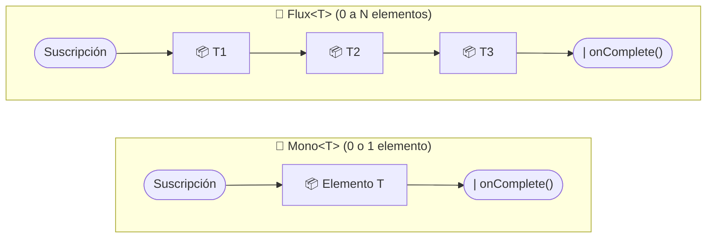
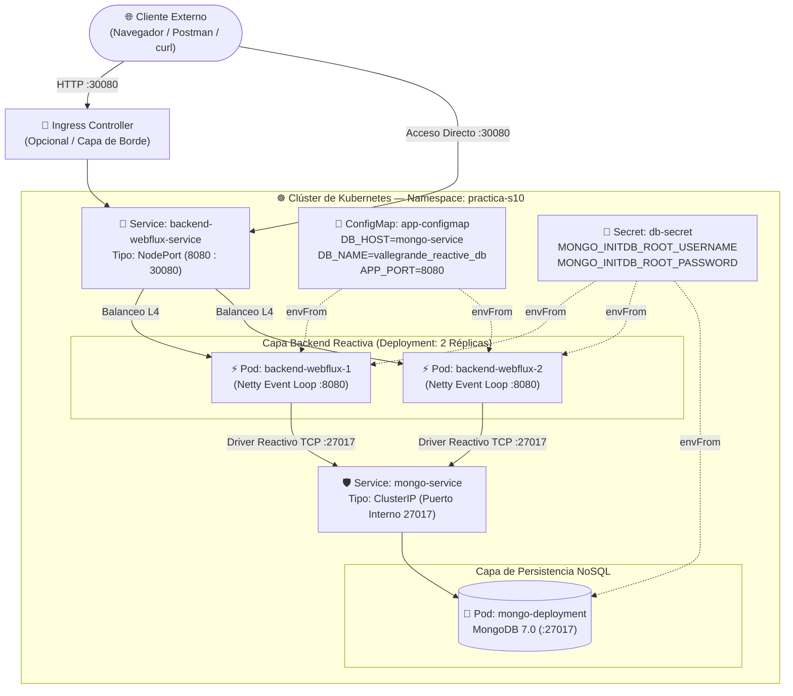

# ☁️ S10 | M10: Despliegue de Backend Spring WebFlux y MongoDB en Kubernetes


---

## 1. 📌 TÍTULO Y DESCRIPCIÓN GENERAL

### Sistema Reactivo Cloud-Native de Dos Capas (Backend WebFlux + NoSQL MongoDB)

Este repositorio implementa una arquitectura de microservicios **100% reactiva, asíncrona y no bloqueante (Non-Blocking I/O)** diseñada bajo estándares **Cloud-Native y DevSecOps** para su despliegue en un clúster de **Kubernetes**.

La solución se compone de dos capas desacopladas dentro de un espacio de nombres aislado (`practica-s10`):
1. **Capa de Negocio y Exposición (Spring WebFlux sobre Netty):** Un microservicio desarrollado con Java 17 y Project Reactor que procesa peticiones concurrentes mediante un **Event Loop** sin bloquear hilos de ejecución, incluso ante picos masivos de tráfico.
2. **Capa de Persistencia NoSQL (MongoDB 7.0):** Una base de datos orientada a documentos protegida mediante aislamiento de red (`ClusterIP`), consumida a través de `spring-data-mongodb-reactive` (MongoDB Reactive Streams Driver).

### Estructura del Repositorio

```text
S10-M10-Despliegue-Spring-WebFlux-y-MongoDB/
├── k8s/
│   ├── 01-app-configmap.yaml       # Variables públicas (DB_HOST, DB_PORT, DB_NAME, APP_PORT)
│   ├── 02-db-secret.yaml           # Credenciales de MongoDB codificadas en Base64
│   ├── 03-mongo-stack.yaml         # Deployment de MongoDB + Service ClusterIP (27017)
│   └── 04-backend-stack.yaml       # Deployment WebFlux (envFrom + Probes) + Service NodePort (30080)
├── src/
│   ├── main/
│   │   ├── java/pe/edu/vallegrande/webfluxk8s/
│   │   │   ├── WebfluxMongoK8sApplication.java
│   │   │   ├── controller/ProductController.java
│   │   │   ├── service/ProductService.java
│   │   │   ├── repository/ProductRepository.java
│   │   │   └── model/Product.java
│   │   └── resources/
│   │       └── application.yml     # Configuración dinámica vinculada a K8s ConfigMap y Secret
│   └── test/
│       └── java/pe/edu/vallegrande/webfluxk8s/service/ProductServiceTest.java
├── Dockerfile                      # Construcción Multi-Stage segura (Non-Root User)
├── pom.xml                         # Dependencias Reactivas y Actuator
├── GUIA_DOCENTE_EN_VIVO.md         # Guion cronometrado paso a paso para el profesor en clase
└── README.md                       # Documentación conceptual y guía práctica de despliegue
```

---

## 2. 🧠 FUNDAMENTOS CONCEPTUALES (EXPLICACIÓN TEÓRICA PARA EL ALUMNO)

### 2.1. Paradigma Reactivo vs. Imperativo

En la arquitectura tradicional (**Spring MVC sobre Apache Tomcat**), cada petición HTTP entrante ocupa un hilo exclusivo del sistema operativo (*One Thread per Request*). Si ese hilo realiza una consulta a la base de datos que tarda `150 ms`, el hilo queda **bloqueado y ocioso** esperando la respuesta. Si llegan `500` peticiones simultáneas y el pool es de `200` hilos, el servicio colapsa por agotamiento de hilos (*Thread Pool Exhaustion*).

Por el contrario, **Spring WebFlux sobre Netty** implementa el patrón **Event Loop**. Un número reducido de hilos (generalmente igual al número de núcleos de CPU) atiende miles de conexiones registrando *callbacks* asíncronos y liberando el hilo inmediatamente mientras la base de datos procesa la consulta.

| Característica | Paradigma Imperativo (Spring MVC) | Paradigma Reactivo (Spring WebFlux) |
| :--- | :--- | :--- |
| **Modelo de Concurrencia** | *One Thread per Request* (1 hilo por petición) | *Event Loop* no bloqueante (pocos hilos, miles de conexiones) |
| **Servidor Embebido por Defecto** | Apache Tomcat (Servlet Container Bloqueante) | Reactor Netty (Asíncrono y orientado a eventos) |
| **Comportamiento en Operaciones I/O** | El hilo se **bloquea** esperando a la Base de Datos | El hilo **se libera** y procesa otras solicitudes (Callback/ Eventos) |
| **Tipos de Retorno** | `Product`, `List<Product>` (Síncronos) | `Mono<Product>`, `Flux<Product>` (Flujos Reactivos Asíncronos) |
| **Control de Flujo (Backpressure)** | No soportado nativamente | Nativo (el consumidor regula la velocidad de emisión del productor) |
| **Consumo de Memoria en Kubernetes** | Alto (cada hilo reserva ~1 MB de Stack en la JVM) | Bajo y predecible (ideal para contenedores con límites estrictos) |

---

### 2.2. Project Reactor: `Mono<T>` y `Flux<T>`

**Project Reactor** es la implementación de la especificación **Reactive Streams** utilizada por Spring WebFlux. Todo flujo reactivo se basa en dos publicadores principales (`Publisher<T>`):

1. **`Mono<T>` (0..1 elemento):** Representa una promesa reactiva que emitirá **como máximo un elemento** (o vacío) y luego completará con éxito (`onComplete`) o con señal de error (`onError`).
   - *Ejemplo de uso:* Buscar un producto por ID (`findById`), crear un documento (`save`), o retornar metadatos del clúster.
2. **`Flux<T>` (0..N elementos):** Representa una secuencia continua o finita de **múltiples elementos** emitidos a lo largo del tiempo, respetando la contrapresión (*Backpressure*).
   - *Ejemplo de uso:* Listar un catálogo de productos (`findAll`) o transmitir eventos en tiempo real mediante *Server-Sent Events (SSE)*.



> [!IMPORTANT]
> **Regla de Oro Reactiva ("Nothing happens until you subscribe"):** En Project Reactor, declarar una cadena de operadores (`map`, `flatMap`, `filter`) solo construye el *pipeline* de ejecución. Los datos no fluyen hasta que existe una **suscripción**. En Spring WebFlux, el propio framework Netty se suscribe automáticamente cuando el controlador retorna un `Mono` o `Flux`.

---

### 2.3. Drivers Reactivos en MongoDB: ¿Por qué es crucial la persistencia no bloqueante?

Un error común de arquitectura es utilizar **Spring WebFlux** en el controlador HTTP, pero conectarse a una base de datos usando un driver tradicional bloqueante (como JDBC estándar o el driver síncrono de MongoDB).

- **¿Qué ocurre si el driver de BD es bloqueante?** Cuando el hilo del *Event Loop* de Netty llega al repositorio, se queda **congelado** esperando la respuesta de red de la base de datos. Como WebFlux tiene muy pocos hilos de Event Loop (ej. 4 u 8 hilos), bloquearlos paraliza todo el microservicio.
- **Solución End-to-End Reactiva (`spring-data-mongodb-reactive`):** Al usar el driver reactivo de MongoDB basado en **Netty NIO**, la consulta viaja como paquetes de red asíncronos. Ni el controlador HTTP, ni el servicio, ni el driver de base de datos bloquean hilos en ningún punto del recorrido.

---

## 3. 🏛️ ARQUITECTURA DE LA SOLUCIÓN EN KUBERNETES

### 3.1. Diagrama de Flujo y Red en el Clúster (`namespace: practica-s10`)



### 3.2. Estrategia de Seguridad y Configuración (DevSecOps & 12-Factor App)

Siguiendo el **Factor III (Config)** de la metodología *The Twelve-Factor App*, la imagen Docker del microservicio (`vallegrande/webflux-mongo-k8s:1.0.0`) es **100% agnóstica del entorno** y no contiene credenciales ni IPs quemadas (*hardcoded*) en su código:

1. **Separación de Parámetros Públicos (`ConfigMap`):**
   - El manifiesto [`01-app-configmap.yaml`](file:///c:/Users/jean.carlos.simon_bl/Documents/Valle%20Grande/S10-M10-Despliegue-Spring-WebFlux-y-MongoDB/k8s/01-app-configmap.yaml) almacena variables de topología (`DB_HOST=mongo-service`, `DB_PORT=27017`, `DB_NAME=vallegrande_reactive_db`, `APP_PORT=8080`).
   - Al usar `DB_HOST: "mongo-service"`, aprovechamos el **servidor DNS interno de Kubernetes (CoreDNS)**: los Pods de Spring WebFlux resuelven automáticamente el nombre `mongo-service` hacia la IP virtual del `ClusterIP` de MongoDB.
2. **Protección de Credenciales (`Secret`):**
   - El manifiesto [`02-db-secret.yaml`](file:///c:/Users/jean.carlos.simon_bl/Documents/Valle%20Grande/S10-M10-Despliegue-Spring-WebFlux-y-MongoDB/k8s/02-db-secret.yaml) encapsula el usuario y contraseña de MongoDB codificados en `Base64`.
   - Tanto el Pod de MongoDB (para inicializar el usuario root) como los Pods de Spring WebFlux (para autenticarse) consumen el **mismo Secret**, garantizando una única fuente de verdad (*Single Source of Truth*).
3. **Aislamiento de Red de la Base de Datos (`ClusterIP` vs. `NodePort`):**
   - **MongoDB usa `ClusterIP`:** Su puerto `27017` es inaccesible desde fuera del clúster. Nadie desde Internet o la red externa puede conectarse directamente a la base de datos.
   - **Spring WebFlux usa `NodePort` (`30080`):** Es la única puerta de entrada autorizada para clientes externos durante la demostración.

---

## 4. 🚀 PASO A PASO DE DESPLIEGUE (GUÍA DE EJECUCIÓN)

### Paso 0: Construcción de la Imagen Docker del Backend

Desde la raíz del proyecto, construye la imagen del microservicio con el tag declarado en el manifiesto `04-backend-stack.yaml`:

```bash
# Construir la imagen Docker multi-stage
docker build -t vallegrande/webflux-mongo-k8s:1.0.0 .
```

> [!TIP]
> **Si utilizas Minikube o Kind:** Carga la imagen local dentro del nodo del clúster para que Kubernetes la encuentre instantáneamente sin buscarla en Docker Hub:
> - **Minikube:** `minikube image load vallegrande/webflux-mongo-k8s:1.0.0`
> - **Kind:** `kind load docker-image vallegrande/webflux-mongo-k8s:1.0.0`
> - **Docker Desktop Kubernetes:** La imagen ya está disponible automáticamente.

---

### Paso 1: Creación del Namespace (`practica-s10`)

Creamos un espacio de nombres lógico para aislar todos los recursos de la sesión:

```bash
kubectl create namespace practica-s10
kubectl get namespaces
```

---

### Paso 2: Aplicación del ConfigMap y Secret

Primero desplegamos la configuración y las credenciales en el clúster antes de levantar los contenedores que dependen de ellas:

```bash
# 1. Aplicar variables públicas (DB_HOST, DB_PORT, DB_NAME, APP_PORT)
kubectl apply -f k8s/01-app-configmap.yaml

# 2. Aplicar credenciales de MongoDB en Base64
kubectl apply -f k8s/02-db-secret.yaml

# 3. Verificar que ambos objetos existen en el namespace practica-s10
kubectl get configmaps,secrets -n practica-s10
```

---

### Paso 3: Despliegue de MongoDB y Validación del Pod

Desplegamos la capa de persistencia NoSQL y su servicio interno `ClusterIP`:

```bash
# Aplicar el Deployment y Service ClusterIP de MongoDB
kubectl apply -f k8s/03-mongo-stack.yaml

# Esperar a que el Pod de MongoDB esté en estado Running (1/1)
kubectl wait --for=condition=ready pod -l app=mongo-db -n practica-s10 --timeout=90s

# Verificar Pod y Service ClusterIP (puerto 27017)
kubectl get pods,svc -l app=mongo-db -n practica-s10
```

---

### Paso 4: Despliegue del Backend Reactivo Spring WebFlux

Con MongoDB operativo y su DNS interno `mongo-service` registrado, desplegamos el microservicio reactivo:

```bash
# Aplicar el Deployment (2 réplicas) y Service NodePort (30080)
kubectl apply -f k8s/04-backend-stack.yaml

# Monitorear el arranque de los Pods hasta que pasen las pruebas de Readiness (1/1 Running)
kubectl get pods -n practica-s10 -w
```

Para ver el estado consolidado de todos los recursos desplegados:

```bash
kubectl get all,configmaps,secrets -n practica-s10
```

---

## 5. 🧪 VERIFICACIÓN Y PRUEBAS DE CONECTIVIDAD

### 5.1. Verificación de Variables de Entorno Inyectadas dentro del Pod (`kubectl exec`)

Comprobamos que Kubernetes inyectó correctamente tanto el `ConfigMap` como el `Secret` dentro del contenedor de Spring WebFlux mediante `envFrom`:

```bash
# Obtener el nombre de uno de los Pods del backend e inspeccionar sus variables de entorno
POD_NAME=$(kubectl get pods -n practica-s10 -l app=backend-webflux -o jsonpath="{.items[0].metadata.name}")
kubectl exec -it $POD_NAME -n practica-s10 -- env | grep -E "DB_|APP_PORT|MONGO_"
```

**En PowerShell (Windows):**
```powershell
$POD_NAME = kubectl get pods -n practica-s10 -l app=backend-webflux -o jsonpath="{.items[0].metadata.name}"
kubectl exec -it $POD_NAME -n practica-s10 -- sh -c "env | grep -E 'DB_|APP_PORT|MONGO_'"
```

**Salida esperada en terminal:**
```text
APP_PORT=8080
DB_HOST=mongo-service
DB_PORT=27017
DB_NAME=vallegrande_reactive_db
MONGO_INITDB_ROOT_USERNAME=admin
MONGO_INITDB_ROOT_PASSWORD=secret123
```

---

### 5.2. Pruebas HTTP al API Reactivo a través del Service `NodePort` (`30080`)

> [!NOTE]
> Si usas **Docker Desktop**, accede directamente a `http://localhost:30080`. Si usas **Minikube**, ejecuta `minikube service backend-webflux-service -n practica-s10 --url` para obtener la IP del nodo.

#### Prueba A: Verificar Diagnóstico de Inyección e Hilo Event Loop de Netty
```bash
curl -s http://localhost:30080/api/v1/products/info
```
**Respuesta JSON esperada:**
```json
{
  "service": "Spring WebFlux + MongoDB Reactive Microservice",
  "podHostname": "backend-webflux-deployment-6b8f9d4c7-x9k2p",
  "reactiveEventLoopThread": "reactor-http-epoll-2",
  "injectedConfigMap": {
    "DB_HOST": "mongo-service",
    "DB_NAME": "vallegrande_reactive_db",
    "APP_PORT": "8080"
  },
  "timestamp": "2026-11-11T15:10:00.123456"
}
```
*(Observa cómo `reactiveEventLoopThread` muestra el hilo no bloqueante `reactor-http-epoll-*` y `podHostname` cambia entre las 2 réplicas al repetir la petición).*

#### Prueba B: Listar el Catálogo Reactivo desde MongoDB (`Flux<Product>`)
```bash
curl -s http://localhost:30080/api/v1/products
```

#### Prueba C: Crear un Nuevo Producto Reactivamente (`Mono<Product>`)
```bash
curl -X POST http://localhost:30080/api/v1/products \
  -H "Content-Type: application/json" \
  -d '{
    "name": "Suscripción Red Hat OpenShift Cloud",
    "category": "Cloud Infrastructure",
    "price": 599.90,
    "stock": 12
  }'
```

#### Prueba D: Streaming Reactivo en Tiempo Real con Server-Sent Events (SSE)
```bash
curl -N http://localhost:30080/api/v1/products/stream
```
*(Verás llegar cada documento desde MongoDB con un intervalo de 1 segundo como eventos `data:{...}` sin bloquear el hilo del servidor).*

---

## 6. 🔍 TROUBLESHOOTING Y BUENAS PRÁCTICAS

### 6.1. Comandos Esenciales de Depuración en Kubernetes

| Escenario de Fallo | Comando de Diagnóstico | ¿Qué buscar en la salida? |
| :--- | :--- | :--- |
| **El Pod se queda en `Pending` o `ContainerCreating`** | `kubectl describe pod <nombre-pod> -n practica-s10` | Revisar la sección final `Events:` por falta de CPU/Memoria o errores al montar el `ConfigMap`/`Secret`. |
| **El Pod muestra `ImagePullBackOff` o `ErrImagePull`** | `kubectl describe pod <nombre-pod> -n practica-s10` | Verificar que la imagen `vallegrande/webflux-mongo-k8s:1.0.0` fue construida y cargada en el nodo del clúster. |
| **El Pod entra en `CrashLoopBackOff`** | `kubectl logs <nombre-pod> -n practica-s10 --previous` | Inspeccionar la traza de Java: credenciales incorrectas en `db-secret` o `DB_HOST` mal escrito en `app-configmap`. |
| **Fallo de conexión entre WebFlux y MongoDB** | `kubectl get endpoints mongo-service -n practica-s10` | Confirmar que `mongo-service` tiene asociada la IP interna del Pod de MongoDB (`10.244.x.x:27017`). |
| **Monitoreo de logs reactivos en vivo** | `kubectl logs -f -l app=backend-webflux -n practica-s10` | Visualizar en tiempo real los logs de las 2 réplicas del backend cuando reciben tráfico HTTP. |

---

### 6.2. Importancia de `Liveness` y `Readiness` Probes en Microservicios Spring Boot

En entornos productivos de Kubernetes, que un contenedor esté en estado `Running` **no significa** que la JVM de Spring Boot ya esté lista para recibir tráfico HTTP. Por ello, en [`04-backend-stack.yaml`](file:///c:/Users/jean.carlos.simon_bl/Documents/Valle%20Grande/S10-M10-Despliegue-Spring-WebFlux-y-MongoDB/k8s/04-backend-stack.yaml) configuramos dos sondas apoyadas en **Spring Boot Actuator**:

1. **`readinessProbe` (`/actuator/health/readiness`):**
   - **¿Qué hace?** Le indica al `Service` de Kubernetes si el Pod está listo para recibir peticiones de los usuarios.
   - **¿Por qué es vital?** Mientras Spring Boot está inicializando el contexto de Netty o reconectándose a MongoDB, la sonda devuelve HTTP `503`. Kubernetes retira temporalmente ese Pod del balanceador de carga sin matarlo, evitando que los clientes reciban errores `502 Bad Gateway`.
2. **`livenessProbe` (`/actuator/health/liveness`):**
   - **¿Qué hace?** Verifica si la aplicación interna sigue viva o si ha caído en un estado irrecuperable (*Deadlock* o corrupción de memoria).
   - **¿Por qué es vital?** Si la sonda falla repetidamente (`failureThreshold: 3`), el `kubelet` reinicia automáticamente el contenedor para auto-recuperar (*Self-Healing*) el servicio sin intervención humana.
